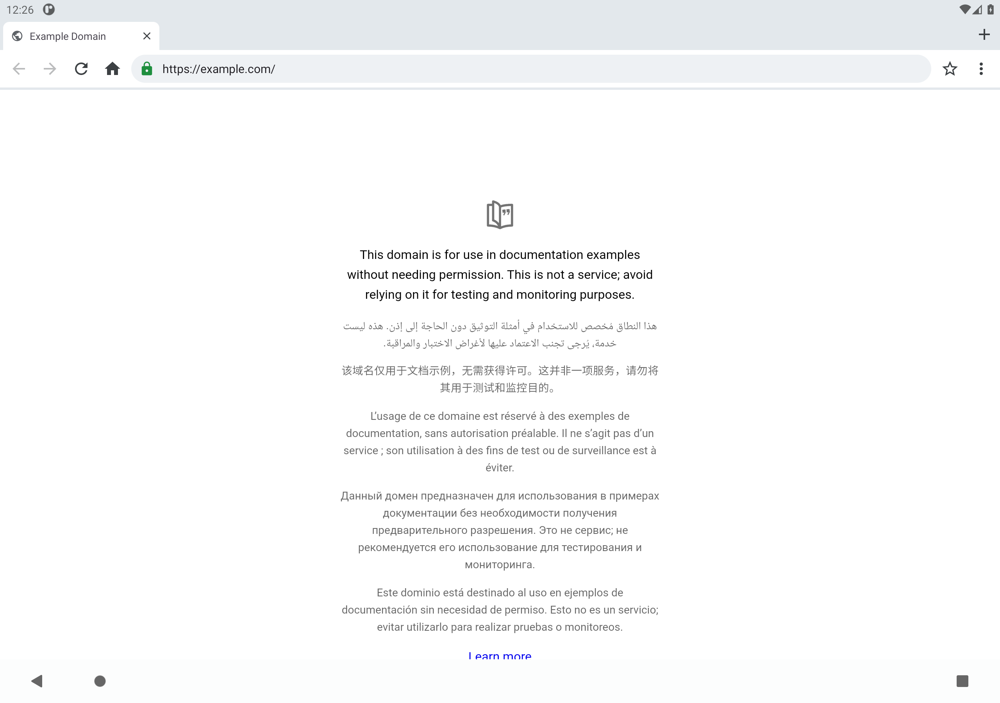
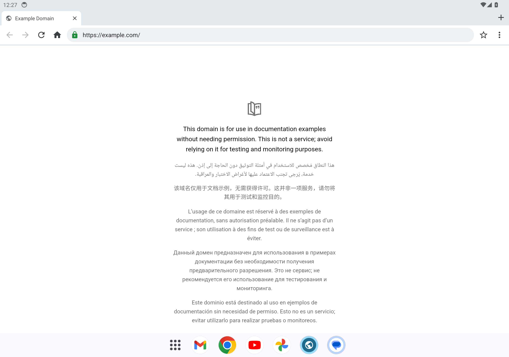

# CI report — run #4

- commit: `57722fa9de8a4cd14068d505f417a1966298fa35` (main, event: push)
- run: https://github.com/lejiyo09/topsecret/actions/runs/40608258476
- app version: 1.0.1 · release signing: ephemeral

| job | result |
|---|---|
| build (compile, unit tests, lint, APKs) | success |
| device-test (emulator API 30 + 34) | success |
| publish (GitHub Release) | success created |

## JVM unit tests
- tests: 16, failures: 0, errors: 0, skipped: 0

## Android Lint (debug)
- Warning: 22

## Release APK
```
file: app/build/outputs/apk/release/app-release.apk
size_bytes: 1820792
sha256: 45f4a66cb0459d359839bd2415f5256e5cb4e06ec3015d51c7c9c8de1228825b

--- apksigner verify
Verifies
Verified using v1 scheme (JAR signing): false
Verified using v2 scheme (APK Signature Scheme v2): true
Verified using v3 scheme (APK Signature Scheme v3): false
Verified using v3.1 scheme (APK Signature Scheme v3.1): false
Verified using v3.2 scheme (APK Signature Scheme v3.2): false
Verified using v4 scheme (APK Signature Scheme v4): false
Verified for SourceStamp: false
Number of signers: 1
V2 Signer: certificate DN: CN=Independent Browser (temporary CI key)
V2 Signer: certificate SHA-256 digest: 904bcea93c3d3038349ec47d2b9c52c0de09389b73d8c4da46cfc296586fb036
V2 Signer: certificate SHA-1 digest: ca618f1b36ca353003a75b3089c11a1a4a50898e
V2 Signer: certificate MD5 digest: 4ad8db803fa6f52aefd6457f236da060
V2 Signer: key algorithm: RSA
V2 Signer: key size (bits): 3072
V2 Signer: public key SHA-256 digest: c4d2cde37e1ff460ed90ce7187977c7d2e2a17b413572ed44d25eb138b702ee3
V2 Signer: public key SHA-1 digest: 989ea048669851ff90512ee5030be86aad65d7f4
V2 Signer: public key MD5 digest: ea42ad352ae177a4e14322c60ae73ba4

--- aapt2 dump badging (selected lines)
package: name='io.github.lejiyo09.independentbrowser' versionCode='10001' versionName='1.0.1' platformBuildVersionName='15' platformBuildVersionCode='35' compileSdkVersion='35' compileSdkVersionCodename='15'
minSdkVersion:'26'
targetSdkVersion:'35'
uses-permission: name='android.permission.INTERNET'
uses-permission: name='android.permission.WRITE_EXTERNAL_STORAGE' maxSdkVersion='28'
uses-permission: name='android.permission.CAMERA'
uses-permission: name='android.permission.RECORD_AUDIO'
uses-permission: name='android.permission.MODIFY_AUDIO_SETTINGS'
uses-permission: name='io.github.lejiyo09.independentbrowser.DYNAMIC_RECEIVER_NOT_EXPORTED_PERMISSION'
application-label:'독립 브라우저'
launchable-activity: name='io.github.lejiyo09.independentbrowser.MainActivity'  label='' icon=''
uses-permission: name='android.permission.READ_EXTERNAL_STORAGE' maxSdkVersion='28'
feature-group: label=''
  uses-feature-not-required: name='android.hardware.camera'
  uses-feature-not-required: name='android.hardware.microphone'
  uses-feature-not-required: name='android.hardware.touchscreen'
supports-screens: 'small' 'normal' 'large' 'xlarge'
densities: '160' '240' '320' '480' '640' '65534'

native_code: none (same APK runs on Intel/AMD and ARM Chromebooks)
```

## Emulator API 30
```
api_level=30
android_release=11
webview=Current WebView package (name, version): (com.google.android.webview, 83.0.4103.106)
screen=Physical size: 2560x1800
instrumentation=pass (OK (10 tests))
release_install=pass
release_launch=pass (pid 5348, no crash)
release_page_rendered=pass (UI tree contains 'Example Domain')
```
Instrumentation output (tail):
```

io.github.lejiyo09.independentbrowser.BrowserInstrumentedTest:..........

Time: 28.225

OK (10 tests)


```


## Emulator API 34
```
api_level=34
android_release=14
webview=Current WebView package (name, version): (com.google.android.webview, 113.0.5672.136)
screen=Physical size: 2560x1800
instrumentation=pass (OK (10 tests))
release_install=pass
release_launch=pass (pid 5448, no crash)
release_page_rendered=pass (UI tree contains 'Example Domain')
```
Instrumentation output (tail):
```

io.github.lejiyo09.independentbrowser.BrowserInstrumentedTest:..........

Time: 61.334

OK (10 tests)


```

